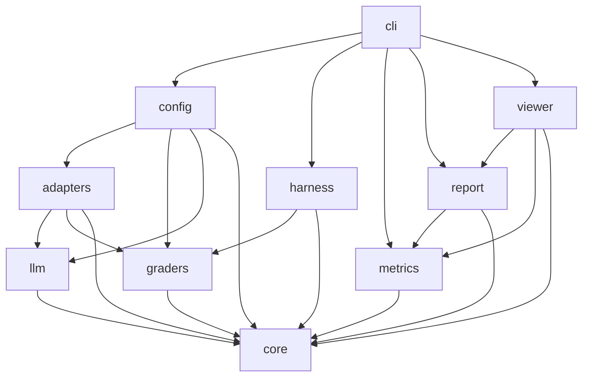
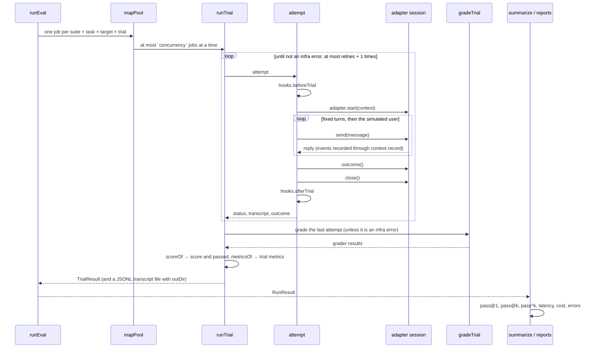

# Architecture

This page explains how `@agent-evals/core` is built: its modules, how a run flows from a task to a
report, and the rules the harness follows for concurrency, retries, timeouts and clean state. It
describes the code in `src/` as it is today.

The method comes from the article
[Demystifying evals for AI agents](https://www.anthropic.com/research/demystifying-evals-for-ai-agents).
The package uses the article's terms: task, trial, grader, transcript, outcome, suite, evaluation
harness and agent harness. The article is credited as the method; it does not endorse this package.

## Modules

| Module   | Files                                                                             | What it does                                                                                                                                                |
| -------- | --------------------------------------------------------------------------------- | ----------------------------------------------------------------------------------------------------------------------------------------------------------- |
| core     | `src/core/types.ts`, `schema.ts`, `loader.ts`, `transcript.ts`                    | The model (tasks, suites, transcripts, results, `InfraError`), the zod schemas of the files, the loader, and helpers that read a transcript.                |
| harness  | `src/harness/run.ts`, `pool.ts`, `simulated-user.ts`, `validate.ts`, `regrade.ts` | Runs trials (`runEval`), limits concurrency (`mapPool`), plays a simulated user, checks reference solutions (`validateSuite`), grades again (`regradeRun`). |
| graders  | `src/graders/grade.ts`, `code.ts`, `judge.ts`, `matchers.ts`, `builtin.ts`        | The grader registry, grading a trial (`gradeTrial`) and scoring it (`scoreOf`), the code graders, the model judge, and the value matchers.                  |
| metrics  | `src/metrics/stats.ts`, `diff.ts`, `lifecycle.ts`, `calibration.ts`               | pass@k, pass^k and the run summary, the comparison of two runs, saturation and graduation, and the judge calibration against human labels.                  |
| report   | `src/report/markdown.ts`, `html.ts`, `reviews.ts`, `write.ts`                     | The Markdown and HTML reports, the failure reviews file, and writing or reading a run folder.                                                               |
| adapters | `src/adapters/scripted.ts`, `openai-tools.ts`, `mock-tools.ts`, `http-sse.ts`     | The built-in adapters: scripted replies, a chat-with-tools loop with mock tools, and an HTTP agent that streams Server-Sent Events.                         |
| llm      | `src/llm/openai-compatible.ts`, `sse.ts`                                          | A streaming client for OpenAI-compatible chat APIs, and a Server-Sent Events reader.                                                                        |
| viewer   | `src/viewer/server.ts`, `page.ts`, `labels-store.ts`                              | The local viewer: a small HTTP server on 127.0.0.1 with one page, and the store of human labels.                                                            |
| config   | `src/config.ts`                                                                   | Reads a YAML, JSON or TypeScript config and turns it into suites, targets, graders and clients.                                                             |
| cli      | `src/cli.ts`                                                                      | The `agent-evals` command. See [the CLI and config reference](cli-and-config.md).                                                                           |

`src/index.ts` is the public API. It re-exports what other code needs from every module.

The arrows below read "imports from". Only `core`, `metrics`, `report` and `viewer` import a package
outside Node's built-ins, and only `zod` and `yaml`.



`adapters` imports `graders` for one function: the mock tools choose a canned response with the same
matchers that the graders use (`matchesAll`).

## The data flow of a run

A run takes suites and targets. It creates one **trial** per task, target and trial number. A trial
makes one or more **attempts**: it retries after an infrastructure error. Each attempt records a
**transcript** and reads the **outcome**. The last attempt is graded. The graders' results become the
trial's **score** and verdict. `summarize` turns the trials into **metrics**, and the reports show
them.



The steps, with the function that does each:

1. **Jobs.** `runEval` (`src/harness/run.ts`) walks every suite, task and target. It skips tasks
   that are not in `tasks` when that option is set. The trial count is the run's `trialsOverride`
   when set (the CLI's `--trials`), else the first of: the task's `trials`, the suite's
   `defaults.trials`, the run's `trials`, or 3. The time limit follows the same order (see below).
2. **Pool.** `mapPool` (`src/harness/pool.ts`) runs the jobs with at most `concurrency` at a time
   (default 4). The results keep the order of the jobs.
3. **Attempt.** `attempt` runs `hooks.beforeTrial`, starts a session with `adapter.start`, sends the
   fixed turns and then the simulated user's messages, reads `session.outcome()`, closes the session
   and runs `hooks.afterTrial`.
4. **Grade.** `gradeTrial` (`src/graders/grade.ts`) runs every grader of the task: the suite's
   `defaults.graders` first, then the task's own.
5. **Score.** `scoreOf` turns the grader results into a score (the weighted mean) and a verdict. See
   [Metrics](metrics.md#partial-credit).
6. **Trial metrics.** `metricsOf` (`src/core/transcript.ts`) reads the transcript: turns, model and
   tool calls, tokens, cost, time to first token and time to reply per turn.
7. **Run metrics.** `summarize` (`src/metrics/stats.ts`) groups the trials per task and per target
   and suite. See [Metrics](metrics.md).
8. **Reports.** `writeReports` (`src/report/write.ts`) writes `run.json`, `summary.json`,
   `report.md` and `report.html`.

This module runs the whole flow on a scripted agent, without a model:

```ts doctest
import {
  defineSuite,
  markdownReport,
  runEval,
  scriptedAdapter,
  summarize,
} from '@agent-evals/core';

const suite = defineSuite({
  name: 'smoke',
  kind: 'regression',
  tasks: [
    {
      id: 'greets',
      input: { turns: ['Hello'] },
      graders: [{ type: 'facts', facts: ['hello'] }],
    },
  ],
});

const run = await runEval({
  suites: [suite],
  targets: [
    {
      name: 'scripted',
      adapter: scriptedAdapter({ replies: { greets: [{ text: 'Hello! How can I help?' }] } }),
    },
  ],
  trials: 3,
});

const summary = summarize(run, { k: 3 });
if (summary.groups[0]?.passHatK !== 1) throw new Error('expected pass^3 = 1');
if (!markdownReport(run, { k: 3, summary }).includes('smoke')) throw new Error('no report');
```

## Concurrency

`mapPool` starts `min(concurrency, jobs)` lanes (at least one). Each lane takes the next job until
none is left. All jobs of a run share the pool, across suites, tasks and targets. So with
`concurrency: 4`, four trials run at the same time, whatever task or target they belong to.

The judge calls of one trial also run in parallel: one call per rubric dimension and judge model.
They are not limited by `concurrency`.

## Attempts and retries

A trial retries only after an **infrastructure error**: an error whose class is `InfraError`, or any
error whose `name` is `'InfraError'`. The run's `retries` option sets how many retries (default 2).
So a trial makes at most `retries + 1` attempts.

- An `InfraError` from `beforeTrial`, `adapter.start`, `send` or `outcome` ends the attempt with
  status `infra_error`, and the harness tries again.
- Any other error from `beforeTrial` is wrapped in an `InfraError` (`beforeTrial failed: …`), and
  a `beforeTrial` that runs past the hook time limit is one too (`beforeTrial took longer than … ms`).
  Resetting the environment is the eval's job, never the agent's.
- A simulated user that throws is wrapped in an `InfraError` too (`the simulated user failed: …`).
- Any other error from the adapter is the agent's: status `agent_error`. It is not retried.

`TrialResult.attempts` counts the attempts. `TrialResult.infraErrors` lists the message of each
infrastructure error, the retried ones included.

When the judge's provider fails after its own retries (see
[Judges and calibration](judges-and-calibration.md#retries-and-time-limits)), the **grading** failed,
not the attempt. The trial keeps its attempt's status, gets `gradingError: 'the judge failed: …'` and
`ungraded: true` (left out of pass@k), and is not retried; `infraErrors` and `attempts` stay about the
attempts. The summary counts these trials as `gradingErrors`, and `regrade` with a judge grades them
again.

## Timeouts and the grace period

Each attempt has a time limit. It is the first of: the task's `timeoutMs`, the suite's
`defaults.timeoutMs`, the run's `timeoutMs`, or 300 000 ms (five minutes). The clock starts after
`beforeTrial`. The hooks have a time limit of their own, the run's `hookTimeoutMs` (default 60 000 ms):
a `beforeTrial` that takes longer ends the attempt as an `infra_error` (and the trial is retried),
never as the agent's `timeout`. The harness can't stop a hung hook; it stops waiting for it, and the hook keeps running beside `afterTrial` and the retry's `beforeTrial` until it ends. A hook that resets shared state should end on its own (a time limit inside it), so a retry never races it.

When the time is up, the harness:

1. aborts `context.signal` with a `Timeout` error, so an adapter that honours the signal stops;
2. stops waiting for the agent and ends the attempt with status `timeout`;
3. records an `error` event of kind `timeout` in the transcript.

An agent may ignore the signal. The harness must not hang on it, so every step after the end of an
attempt waits at most a **grace period** (`graceMs`, 10 seconds):

- **A pending start.** If the time ran out while `adapter.start` was still pending, the harness
  waits up to 10 s for it. When the session arrives, it is read and closed like any other. The agent
  may have opened a conversation that needs closing.
- **The outcome.** After a failed attempt (timeout, agent error, infrastructure error) the harness
  still reads `session.outcome()`, waiting up to 10 s. A failed trial can still have changed the
  environment, and the graders should see that.
- **Close.** `session.close()` gets up to 10 s.
- **afterTrial.** `hooks.afterTrial` gets up to `hookTimeoutMs` (default 60 s). Its failures are
  ignored.

`within(promise, ms)` implements the wait. It returns the value, or `undefined` when the promise
rejects or does not settle in time. So after a failed attempt an `outcome()` that rejects or hangs
gives an outcome of `null`, and a `close()` that rejects is ignored. After a conversation that
ended normally, `outcome()` runs inside the attempt: if it rejects, the trial ends as `agent_error`
(or `infra_error` for an `InfraError`) with that error. A _synchronous_ throw from `outcome`, `close`,
`beforeTrial` or `afterTrial` is handled exactly like a rejection: it never escapes `runEval`.

**The transcript is frozen when the attempt ends.** The attempt returns a copy of the transcript. An
agent that keeps running after the timeout and calls `context.record` later changes nothing that is
graded. When the attempt fails, the copy is taken after the outcome is read, so events recorded while
reading the outcome are kept.

## Statuses

Every trial has one `status`:

| Status        | When                                                    | Graded | In pass@k  |
| ------------- | ------------------------------------------------------- | ------ | ---------- |
| `completed`   | The conversation ended and the outcome was read.        | yes    | yes        |
| `agent_error` | The adapter threw an error that is not an `InfraError`. | yes    | yes, fails |
| `timeout`     | The attempt ran past its time limit.                    | yes    | yes, fails |
| `infra_error` | Every attempt hit an infrastructure error.              | no     | no         |

An `agent_error` or `timeout` trial is still graded, so the report shows what its graders found. Its
`score` is set to 0 and `passed` to false all the same.

A trial can also be **ungraded**: `ungraded: true` on a trial whose status is not `infra_error`.
That happens when the trial has no verdict although the task has graders: every grader of the task
is a model grader and the run has no judge, or the judge's provider failed (`gradingError`). An
ungraded trial has score 0, does not pass, and is left
out of pass@k like an infrastructure error. So a dry run can't pass a task it never graded.

A grader that throws does not change the status. It counts as a failed grader with an `error`, and
the reports count it as a grader error, not as the agent's.

## Clean state per trial

Every attempt starts a new session with `adapter.start`. The harness shares nothing between trials.
What the agent may change outside the session (a database, a file, a ticket) is reset by the run's
hooks:

- `hooks.beforeTrial(context)` runs before every attempt: re-seed the data, start a fresh account.
  It runs again before a retry. If it throws, the attempt is an infrastructure error.
- `hooks.afterTrial(context)` runs after every attempt, also after a failed one: undo a write,
  delete what the trial created. When it rejects, the error is ignored; the trial's result stays
  as it is.

The `context` is the same `TrialContext` the adapter gets: the suite, the task, the target's name and
the trial number. See [Extending](extending.md#hooks).

The built-in `openai-tools` adapter needs no hook. Its mock tools copy `input.context.state` for each
trial with `structuredClone`, so trials share nothing.

## The conversation and the simulated user

`converse` sends the task's fixed `input.turns` one by one. After each reply it stops early when the
reply says `done: true`. Then, when the task has `input.user`, a **simulated user** takes over: a
second model with the task's persona and goal. It writes the next user message after each reply. The
conversation ends when:

- the simulated user answers with the stop token `<<DONE>>` (or an empty message),
- the agent's reply says `done: true`,
- or the user has sent `maxTurns` messages (default 6, the fixed turns and the first message
  included).

A task with `input.user` needs a simulator in the run. Without one, `runEval` throws before any trial
starts: `<suite>/<task>: the task has a simulated user, but the run has no userSimulator`.

`userSimulator: 'reference'` replays the user messages of the task's reference transcript instead of
a model. This makes a dry run of a conversational task possible without an API key. The details are
in [Judges and calibration](judges-and-calibration.md#the-simulated-user).

## Regrade

`regradeRun(run, { suites, graders, judge? })` (`src/harness/regrade.ts`) grades a stored run again.
It reads each trial's transcript and outcome from `run.json` and does not call the agent. Use it after
a grader or a task was found unfair while reading transcripts.

- It uses the suites' current tasks and graders.
- Without a judge, model graders are not run again: their earlier results are kept.
- A trial whose task is gone, and an `infra_error` trial, keep their old grades.
- It adds `regradedAt` to the run's `meta`.

The CLI's `regrade` command calls it and writes the reports again. See
[the CLI and config reference](cli-and-config.md).

## Design principles

- **Few dependencies.** The package depends on `zod` (the file schemas) and `yaml` (the files)
  and on Node's built-ins. Nothing else. A test in `test/core.test.ts` fails on any other import.
- **TypeScript without a build, today.** Node 22.18 and later run `.ts` files directly by type
  stripping. The source therefore uses only erasable syntax: no enums, no namespaces, no parameter
  properties, and relative imports end in `.ts`. Node refuses to strip types of files under
  `node_modules`, so a build step that emits JavaScript lands before the first npm release. Until
  then the package runs from source.
- **Files as the interface.** Tasks and suites are YAML or JSON files. A run is a folder:
  `run.json`, the reports, and one JSONL transcript per trial. No database, no service.
- **Local first.** Nothing leaves the machine except the calls that the adapters and the judge
  make. The viewer listens on 127.0.0.1 only.
- **Outcome over path.** Code graders check what the agent did to the environment and what it said.
  They don't require one exact sequence of calls.
- **Infrastructure apart.** An infrastructure error is never the agent's failure. It is retried,
  counted apart and left out of pass@k.
- **No real model in tests.** The package's own tests use the `scripted` adapter and fakes of
  `fetch`.
